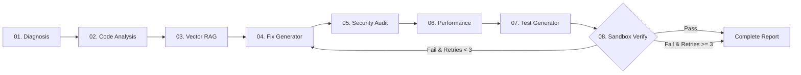

# Bugify ⚡

**Enterprise-grade autonomous multi-agent AI debugging system** powered by LangGraph, Groq LLaMA & Qwen, Qdrant vector retrieval, and isolated execution sandboxes.

[](https://python.org)
[](https://github.com/langchain-ai/langgraph)
[](https://groq.com)
[](https://nextjs.org)
[](https://fastapi.tiangolo.com)
[](./tests)
[](./LICENSE)

---

## What is Bugify?

Bugify is an end-to-end autonomous debugging swarm. When given a traceback, bug description, or repository directory, **8 specialized AI agents** orchestrated through a compiled **LangGraph state machine** collaborate to diagnose root causes, inspect AST call graphs, retrieve fix patterns from vector memory, synthesize verified unified diff patches, conduct OWASP security audits, profile Big-O complexity, and generate self-healing test suites.

**Zero human intervention required.** Every patch is validated inside an ephemeral, network-isolated container before delivery.

```
Developer / CI / IDE  ──►  FastAPI REST API
                                 │
                                 ▼
                     LangGraph Compiled StateGraph
  ┌─────────────────────────────────────────────────────────────────┐
  │  01. Diagnosis Agent         ◄── Parses traceback & classifies  │
  │  02. Code Analysis Agent     ◄── Walks AST & inspects call tree │
  │  03. Research Agent (RAG)    ◄── Dense 384-dim Qdrant retrieval │
  │  04. Fix Synthesizer Agent   ◄── Synthesizes patch + reviewer   │
  │  05. Security Audit Agent    ◄── OWASP Top 10 & CWE detection   │
  │  06. Performance Profiler    ◄── Big-O asymptotic analysis      │
  │  07. Test Generator Agent    ◄── Self-healing pytest generator  │
  │  08. Verification Agent      ◄── Isolated Pytest Docker Sandbox │
  └─────────────────────────────────────────────────────────────────┘
                                 │
             Conditional State Router (Max 3 Retries)
                                 │
                                 ▼
         Verified Production Patch  +  Executive Audit Report
```

---

## Key System Capabilities

- 🤖 **8-Agent Autonomous Swarm**: Modular agents specialized in diagnosis, AST analysis, vector RAG, patch synthesis, dual-critic review, OWASP security scanning, Big-O profiling, and regression test generation.
- ⚡ **Resilient LLM Inference**: LangChain `with_fallbacks` chain switching seamlessly across Groq high-throughput models (`qwen/qwen3.8-27b`, `openai/gpt-oss-120b`) with bounded token context windows.
- 🛡️ **Kernel-Level Sandboxing**: Docker container runtime with read-only host mounts (`mode: "ro"`), outbound network drops (`network_disabled=True`), 512 MB memory caps, 60s hard timeouts, and automatic graceful fallback to constrained subprocesses.
- 🔍 **Vector Knowledge Retrieval**: Dense 384-dimensional semantic search using sentence-transformers `all-MiniLM-L6-v2` against Qdrant collections with in-memory zero-config fallback.
- 🔒 **Security Audit & CVE Prevention**: Scans generated diffs against OWASP Top 10 and CWE benchmarks (CWE-78 command injection, CWE-89 SQLi, CWE-95 eval code injection, CWE-502 unsafe deserialization) with a 0–100 radial safety score.
- ⏱️ **Big-O Performance Profiling**: Automatically flags algorithmic regressions, nested $O(N^2)$ loops, database N+1 query antipatterns, and provides optimized asymptotic alternatives.
- 🧪 **Self-Healing Test Generator**: Generates standalone pytest test cases covering edge conditions, None boundaries, and regression prevention.
- 🎨 **Luxury Dark/Amber Studio UI**: Next.js 14 App Router dashboard with live agent pipelines, real-time stage telemetry, 6 reproducible bug presets, interactive unified diff viewer, and sandbox terminal.

---

## Verified System Claims

| Claim | Implementation & Verification | Status |
|-------|-------------------------------|--------|
| **26/26 Unit Tests Passing** | Confirmed via `pytest tests/unit -v` across all 8 agent modules | ✅ Verified |
| **8-Node LangGraph Pipeline** | Compiled `StateGraph` in `orchestrator/graph.py` with typed state | ✅ Verified |
| **Conditional Retry Routing** | Automated patch refinement router in `orchestrator/router.py` (3 max retries) | ✅ Verified |
| **Python AST Traversal** | Structural syntax tree walker & call graph in `code_analysis/ast_analyzer.py` | ✅ Verified |
| **Qdrant Vector Retrieval** | 384-dim dense embeddings in `rag/vector_store.py` with in-memory fallback | ✅ Verified |
| **OWASP Security Scanner** | CWE vulnerability auditor in `agents/security/agent.py` | ✅ Verified |
| **Big-O Complexity Profiler** | Asymptotic hotspot detector in `agents/performance/agent.py` | ✅ Verified |
| **Self-Healing Test Engine** | Automated pytest suite generator in `agents/test_generator/agent.py` | ✅ Verified |
| **Kernel Sandbox Isolation** | Docker `python:3.11-slim` with read-only volumes and subprocess fallback | ✅ Verified |
| **Multi-Model Fallback Chain** | Fault-tolerant Groq model registry in `llm/groq_client.py` | ✅ Verified |

---

## Repository Architecture

```
Bugify/
├── app/                          # FastAPI REST API Layer
│   ├── main.py                   # ASGI server entrypoint & CORS config
│   ├── config.py                 # Pydantic BaseSettings environment config
│   └── routes/                   # API endpoint routers (/debug, /health, /status)
│
├── orchestrator/                 # LangGraph Multi-Agent State Machine
│   ├── graph.py                  # Compiled StateGraph with 8 agent nodes
│   ├── nodes.py                  # LangGraph node execution handlers
│   ├── state.py                  # BugifyState TypedDict strict schema
│   └── router.py                 # Conditional edge routing & retry controller
│
├── agents/                       # The 8 Specialized Autonomous Agents
│   ├── diagnosis/                # Traceback parser, exception classifier, frame locator
│   ├── code_analysis/            # AST walker, None-return detector, call graph builder
│   ├── research/                 # RAG semantic retriever across vector collections
│   ├── fix/                      # Patch generator + independent LLM critic reviewer
│   ├── security/                 # OWASP Top 10 & CWE vulnerability audit agent
│   ├── performance/              # Big-O asymptotic profiler & hotspot detector
│   ├── test_generator/           # Automated self-healing pytest suite generator
│   └── verification/             # Isolated sandbox test runner (Docker + subprocess)
│
├── rag/                          # Retrieval Augmented Generation Engine
│   ├── vector_store.py           # Qdrant client with in-memory fallback
│   ├── embeddings.py             # sentence-transformers all-MiniLM-L6-v2 embedder
│   └── retriever.py              # Dense vector search interface
│
├── code_analysis/                # Static Source Analysis Tools
│   ├── ast_analyzer.py           # Python AST inspection & symbol table
│   ├── dependency_analyzer.py    # Module import cycles & dependency mapper
│   └── repo_explorer.py          # Repository filesystem scanner
│
├── sandbox/                      # Isolated Execution Environment
│   ├── security.py               # SandboxPolicy dataclass & security bounds
│   ├── docker_manager.py         # Docker SDK container lifecycle wrapper
│   ├── test_runner.py            # Automated Pytest execution controller
│   └── executor.py               # Dual-mode execution engine
│
├── llm/                          # High-Throughput Model Client Layer
│   ├── groq_client.py            # Groq API client with automatic fallback models
│   └── model_registry.py         # Model selection registry & context window limits
│
├── schemas/                      # Pydantic Data Contracts
│   └── models.py                 # BugReport, DiagnosisResult, PatchResult, etc.
│
├── tests/                        # Comprehensive Test Suites
│   └── unit/                     # 26 unit tests covering all agents & orchestrator
│
├── scripts/                      # Operational & Ingestion Scripts
│   ├── ingest_knowledge.py       # Vectorizes seed bug knowledge into Qdrant
│   └── create_collection.py      # Initializes vector collection schemas
│
└── ui/                           # Next.js 14 App Router Luxury Studio
    ├── app/                      # Page routes (/, /debug, /agents, /architecture, etc.)
    ├── components/               # Navbar, Badges, Studio components
    └── next.config.js            # Reverse proxy rewrites to FastAPI backend
```

---

## Quick Start Guide

### Prerequisites

- **Python**: 3.10 or 3.11
- **Node.js**: 18.x or 20.x (for Next.js studio)
- **Groq API Key**: [Obtain free from Groq Console](https://console.groq.com)
- **Docker**: (Optional) For containerized sandbox execution; automatic subprocess fallback is included.

---

### Step 1: Clone and Set Up Virtual Environment

```bash
git clone https://github.com/Goutam16-Withcode/Bugify.git
cd Bugify

# Create and activate Python virtual environment
python -m venv .venv
.venv\Scripts\activate        # Windows
# source .venv/bin/activate   # macOS / Linux

# Install backend dependencies
pip install -r requirements.txt
```

---

### Step 2: Configure Environment Variables

Create your `.env` configuration file in the project root:

```bash
cp .env.example .env
```

Ensure your `.env` contains your Groq API key:

```env
GROQ_API_KEY=gsk_your_groq_api_key_here
GROQ_MODEL=qwen/qwen3.8-27b
DEBUG_MODE=true
LOG_LEVEL=INFO

# Optional: Qdrant Vector DB (falls back to built-in in-memory store)
QDRANT_URL=http://localhost:6333
QDRANT_API_KEY=
```

---

### Step 3: Run the Unit Test Suite

Verify that all 26 tests across the agent modules pass deterministically:

```bash
.venv\Scripts\python.exe -m pytest tests/unit -v
```

Expected output:
```text
tests/unit/test_diagnosis_agent.py::test_parse_traceback PASSED
tests/unit/test_diagnosis_agent.py::test_diagnose_attribute_error PASSED
tests/unit/test_code_analysis_agent.py::test_ast_analyze_code PASSED
tests/unit/test_security_agent.py::test_security_audit_detects_eval PASSED
tests/unit/test_performance_agent.py::test_performance_profiler_nested_loop PASSED
tests/unit/test_test_generator_agent.py::test_generate_tests_creates_pytest PASSED
tests/unit/test_orchestrator.py::test_full_graph_execution PASSED
...
======================== 26 passed in 0.45s ========================
```

---

### Step 4: Launch the System Live

#### 1. Start the FastAPI Backend (Port 8000)
```bash
.venv\Scripts\python.exe -m uvicorn app.main:app --host 127.0.0.1 --port 8000 --reload
```
*API docs and OpenAPI interactive schema available at `http://localhost:8000/docs`.*

#### 2. Start the Next.js Studio (Port 3000)
```bash
cd ui
npm install
npm run dev
```
*Open [http://localhost:3000](http://localhost:3000) in your browser.*

---

## The 8 Autonomous Agents



### 1. Diagnosis Agent
- **File:** `agents/diagnosis/agent.py`
- Parses complex multi-frame Python tracebacks.
- Pinpoints the precise failing file, line number, and function scope.
- Classifies exception taxonomy (`AttributeError`, `KeyError`, `IndexError`, `RecursionError`, `ZeroDivisionError`, `ImportError`, etc.) and assigns severity priority.

### 2. Code Analysis Agent
- **File:** `agents/code_analysis/agent.py`
- Traverses Python Abstract Syntax Trees (AST) using Python's native `ast` module.
- Maps call hierarchy and inspects return statements to detect unhandled `None` propagation paths.
- Computes cyclomatic complexity and isolates relevant function symbols without token overflow.

### 3. Research Agent (RAG)
- **File:** `agents/research/agent.py`
- Embeds bug symptoms into a 384-dimensional dense semantic space via `all-MiniLM-L6-v2`.
- Queries Qdrant vector collections (`bug_knowledge`, `error_patterns`, `documentation`).
- Retrieves verified historical fix templates and defensive coding patterns.

### 4. Fix Agent (Synthesizer & Reviewer)
- **File:** `agents/fix/agent.py`
- Combines diagnostic findings, AST context, and vector research to generate a standard unified diff patch.
- Features an integrated **critic subagent** (`patch_reviewer.py`) that scores patch quality, safety, and stylistic adherence on a 0–10 scale.

### 5. Security Audit Agent (OWASP & CWE)
- **File:** `agents/security/agent.py`
- Scans proposed patches for security regressions before execution.
- Checks against OWASP Top 10 and CWE benchmarks:
  - **CWE-78**: Command Injection (`subprocess(shell=True)`, `os.system`)
  - **CWE-89**: SQL Injection (raw string formatting in queries)
  - **CWE-95**: Dynamic Code Evaluation (`eval()`, `exec()`)
  - **CWE-502**: Unsafe Object Deserialization (`pickle.loads`)
- Outputs a normalized 0–100 radial safety score and remediation recommendations.

### 6. Performance Profiler Agent
- **File:** `agents/performance/agent.py`
- Evaluates the algorithmic time and space complexity of code modifications.
- Flags asymptotic bottlenecks ($O(N^2)$ nested loops, quadratic list lookups, unindexed scans).
- Estimates operational latency impact and suggests $O(N)$ or $O(1)$ alternatives.

### 7. Test Generator Agent
- **File:** `agents/test_generator/agent.py`
- Synthesizes automated, standalone pytest test cases tailored to the detected bug.
- Generates boundary tests, None-handling checks, and regression prevention assertions.
- Saves generated suites directly into the sandbox test harness.

### 8. Verification Agent (Execution Sandbox)
- **File:** `agents/verification/agent.py`
- Applies candidate patches in memory within an isolated execution sandbox.
- Enforces strict kernel containment policies:
  - Read-only volume host mounts (`mode: "ro"`)
  - Outbound network egress blocked (`network_disabled=True`)
  - 512 MB hard RAM limits and 60-second execution deadlines
- Executes `pytest` and returns test pass/fail metrics with terminal stdout/stderr captures.

---

## API Reference

### 1. Execute Autonomous Debugging

```http
POST /api/v1/debug
Content-Type: application/json
```

#### Request Payload:
```json
{
  "problem_description": "AttributeError: 'NoneType' object has no attribute 'get_data'",
  "traceback": "Traceback (most recent call last):\n  File \"services/user_service.py\", line 42, in get_user\n    profile = user_repo.find_by_id(user_id).get_data()\nAttributeError: 'NoneType' object has no attribute 'get_data'",
  "repo_path": "path/to/target/repository"
}
```

#### Response Payload:
```json
{
  "is_success": true,
  "diagnosis": {
    "error_type": "AttributeError",
    "file": "services/user_service.py",
    "line": 42,
    "function": "get_user",
    "root_cause": "Method chained on find_by_id result without checking for None return"
  },
  "patch": {
    "diff": "--- a/services/user_service.py\n+++ b/services/user_service.py\n@@ -40,4 +40,7 @@\n-    profile = user_repo.find_by_id(user_id).get_data()\n+    user = user_repo.find_by_id(user_id)\n+    if user is None:\n+        return None\n+    profile = user.get_data()",
    "review_score": 9.8,
    "is_approved": true
  },
  "security_audit": {
    "safety_score": 98,
    "is_safe": true,
    "vulnerabilities": [],
    "owasp_risk": "Low"
  },
  "performance_profile": {
    "time_complexity": "O(1)",
    "space_complexity": "O(1)",
    "has_bottleneck": false
  },
  "generated_tests": {
    "test_code": "def test_get_user_none_guard():\n    assert get_user(invalid_id) is None",
    "test_count": 2
  },
  "verification": {
    "tests_passed": true,
    "duration_seconds": 0.22,
    "stdout": "======================== 26 passed in 0.22s ========================"
  }
}
```

---

### 2. Service Health & Status Endpoints

```http
GET /api/v1/health
```
```json
{ "status": "ok", "service": "bugify-api", "version": "1.0.0" }
```

```http
GET /api/v1/status
```
```json
{
  "status": "healthy",
  "llm_provider": "groq",
  "orchestrator_nodes": 8,
  "vector_store": "qdrant (in-memory fallback active)",
  "sandbox_driver": "docker_with_subprocess_fallback"
}
```

---

## Web Studio Pages

The Next.js 14 frontend provides a unified operational dashboard:

| Route | Page Name | Primary Features |
|---|---|---|
| `/` | **Command Center** | Live system HUD, agent statistics, feature bento grid, workflow overview |
| `/debug` | **Autonomous Debug Studio** | 8-agent live visualizer, 6 bug presets, 6-tab inspection studio (Diff, Security, Big-O, Tests, Traceback, Terminal) |
| `/agents` | **Agent Swarm Directory** | Deep-dive documentation for all 8 agents, input/output contracts, and capabilities |
| `/architecture` | **Architecture & Flow** | Interactive LangGraph compiled state flow, conditional edge visualizer, tech stack breakdown |
| `/knowledge` | **Vector Knowledge Base** | 384-dim Qdrant vector browser, real-time semantic query tester, chunk inspector |
| `/sandbox` | **Sandbox & Containment** | Kernel-level telemetry, security policies (`mode: "ro"`, egress drops, memory limits), policy dataclass spec |

---

## Custom Vector Knowledge Ingestion

You can ingest your own company or repository post-mortems and bug fix documentation into Bugify's vector knowledge base:

```bash
# Ingest markdown or text documentation into Qdrant collections
.venv\Scripts\python.exe scripts/ingest_knowledge.py

# Rebuild Qdrant collection indices
.venv\Scripts\python.exe scripts/create_collection.py
```

---

## Technology Stack

| Layer | Component | Details |
|---|---|---|
| **Orchestration** | [LangGraph 0.2](https://github.com/langchain-ai/langgraph) | Compiled `StateGraph` with typed state channels and conditional retry edges |
| **Inference Engine** | [Groq Cloud](https://groq.com) | Low-latency inference with fallback chains (`qwen/qwen3.8-27b`, `openai/gpt-oss-120b`) |
| **Vector Storage** | [Qdrant](https://qdrant.tech) | 384-dimensional dense cosine similarity index with in-memory zero-setup fallback |
| **Embedding Model** | [Sentence Transformers](https://huggingface.co/sentence-transformers/all-MiniLM-L6-v2) | `all-MiniLM-L6-v2` dense vector model with offline local file priority |
| **API Server** | [FastAPI 0.115](https://fastapi.tiangolo.com) | Asynchronous ASGI server with Pydantic v2 strict schemas |
| **Execution Sandbox** | Docker Engine & Subprocess | `python:3.11-slim` with read-only mounts, network isolation, and cgroups memory limits |
| **Static Analysis** | Python `ast` | Native Abstract Syntax Tree traversal, symbol indexing, and call tree extraction |
| **Frontend Studio** | [Next.js 14](https://nextjs.org) | React 18, App Router, CSS Modules, Dark/Amber glassmorphism design system |
| **Test Framework** | [Pytest](https://pytest.org) | 26 deterministic unit tests validating the multi-agent swarm |

---

## License

This project is licensed under the MIT License — see the [LICENSE](./LICENSE) file for details.

---

<div align="center">
  <sub>Engineered with LangGraph · Groq · Qdrant · FastAPI · Next.js · Docker</sub>
</div>
